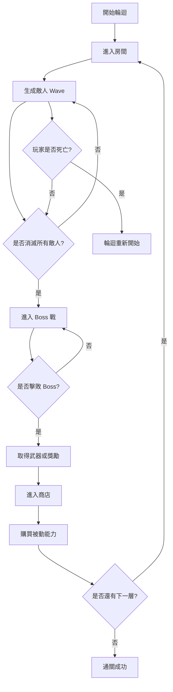

# 🏺 Egyptian Roguelike

> **古埃及神話 × Pixel Art × Roguelike**

一款以古埃及神話為背景的 2D Roguelike 動作遊戲。玩家將扮演一名獲得特殊靈能的亡故農夫，穿越冥界、擊敗各層敵人與 Boss，並透過武器及被動能力的組合逐漸強化自己，最終抵達傳說中的「蘆葦原」。

---

## 📖 目錄

- [遊戲介紹](#-遊戲介紹)
- [故事背景](#-故事背景)
- [遊戲核心特色](#-遊戲核心特色)
- [遊戲玩法與機制](#-遊戲玩法與機制)
- [武器系統](#-武器系統)
- [角色能力與被動技能](#-角色能力與被動技能)
- [關卡設計](#-關卡設計)
- [敵人與 Boss 系統](#-敵人與-boss-系統)
- [遊戲流程](#-遊戲流程)
- [視覺風格](#-視覺風格)
- [目標客群與平台](#-目標客群與平台)
- [開發分工](#-開發分工)

---

## 🎮 遊戲介紹

| 項目 | 內容 |
|---|---|
| 遊戲類型 | Roguelike / 2D Action |
| 遊戲主題 | 古埃及神話 |
| 視覺風格 | Egyptian Mythology × Pixel Art |
| 操作方式 | WASD 移動、滑鼠瞄準與攻擊 |
| 玩法參考 | 元氣騎士 |
| 目標平台 | itch.io、Steam |

### 遊戲簡介

利用擊敗敵人後掉落的武器，以及角色不斷累積的被動能力，創造不同的戰鬥策略，消滅敵人並逐層深入冥界，最終抵達底層。

遊戲採用 Roguelike 設計，每次冒險都會遇到不同的敵人組合，並透過武器、技能與角色能力的搭配，形成不同的戰鬥體驗。

### 故事背景

整天將靈魂打入徹底的虛無，實在算不上什麼有趣的消遣——這一點，阿努比斯深有體會。

於是，他賜予了一個不幸的靈魂第二次機會。

這位古埃及的亡故農夫獲得了吸收靈能的力量。他必須穿越冥界，擊敗阻擋在前方的敵人與神祇，憑藉這股借來的力量，一步步踏入傳說中的「蘆葦原」。

---

## ✨ 遊戲核心特色

### 1. Power Fantasy（力量成長）

玩家能夠透過擊敗敵人、取得武器及升級被動能力，不斷強化角色。

隨著冒險進度推進，角色可以累積攻擊力、生命值、爆擊率等能力，逐漸形成強大的戰鬥組合。

### 2. Risk vs. Reward（風險與報酬）

透過金幣、商店及不同的戰鬥選擇，讓玩家在資源有限的情況下決定如何強化角色。

玩家需要考慮：
- 優先提升生命值，增加生存能力。
- 投資攻擊力，提高戰鬥效率。
- 提升掠奪能力，增加後續可取得的資源。

### 3. Synergies（能力組合）

不同武器與被動能力可以互相搭配，形成不同的戰鬥策略。

例如：
- 高攻速武器 + 攻擊力提升。
- 高傷害武器 + 爆擊率提升。
- 遠距離武器 + 移動速度提升。
- 召喚法陣 + 特定被動能力。

### 4. Unique Encounters（特殊遭遇）

不同關卡具有不同的敵人組合及 Boss。

擊敗 Boss 後，玩家可以獲得新的攻擊方式，並可進一步設計成繼承或吸收 Boss 特性的機制，使每次冒險具有不同的戰鬥變化。

---

## ⚙️ 遊戲玩法與機制

### 基本操作

| 操作 | 功能 |
|---|---|
| W | 向上移動 |
| A | 向左移動 |
| S | 向下移動 |
| D | 向右移動 |
| 滑鼠移動 | 瞄準 |
| 滑鼠點擊 | 攻擊 |

### 大致遊戲機制

- 遊戲採用多層房間式地圖。
- 每個房間具有不同的障礙物，例如柱子與牆壁。
- 玩家需要在房間內消滅固定數量的敵人波次。
- 最後一波通常為 Boss 戰。
- 擊敗敵人可以獲得金幣。
- 完成房間後，可以使用金幣購買被動能力或取得新的攻擊方式。
- 完成當前房間後進入下一層。
- 隨著關卡推進，敵人難度逐漸提升。

### 角色生命值

角色具有多格生命值，不需要完全依賴閃避來避免所有傷害。

玩家可以透過生命值與其他防禦相關能力承受一定程度的傷害，使戰鬥更著重於攻擊、走位與策略選擇。

### Roguelike 隨機元素

遊戲的隨機性主要來自：

- 每波敵人的種類與組合。
- 武器取得與選擇。
- 被動技能與能力升級。
- 商店商品的隨機抽選。

### 死亡與輪迴

- 玩家死亡後，當前輪迴重新開始。
- 每次死亡都代表一次輪迴結束。
- 記錄玩家成功通關的輪迴次數。
- 可進一步加入輪迴紀錄，讓玩家挑戰更高的通關次數。

---

## ⚔️ 武器系統

武器是角色主要的攻擊方式，不同武器具有不同的攻擊 Pattern、攻擊距離、攻擊速度與操作方式。

### 武器種類

| 武器 | 攻擊距離 | 攻擊方式 | 特色 |
|---|---|---|---|
| 刀 | 近距離 | 揮砍 | 基礎近戰武器 |
| 重型刀 | 近距離 | 揮砍／蓄力 | 高傷害、較慢攻速 |
| 快速刀 | 近距離 | 快速揮砍 | 高攻速 |
| 蓄力刀 | 近距離 | 蓄力攻擊 | 透過蓄力提高攻擊效果 |
| 弓 | 遠距離 | 蓄力射擊 | 需要蓄力才能攻擊 |
| 弩 | 遠距離 | 直接射擊 | 不需要蓄力 |
| 法器／召喚 | 遠距離 | 指定位置施放 | 在指定位置放置法陣或召喚物 |

### 攻擊模式

不同武器可以使用不同的操作方式：

- **戳刺：** 朝滑鼠方向進行直線攻擊。
- **揮砍：** 以角色為中心進行扇形攻擊。
- **蓄力：** 按住攻擊鍵累積力量，再釋放攻擊。
- **投射物：** 發射箭矢等遠距離攻擊。
- **指定施放：** 在滑鼠指定位置放置法陣或召喚物。

部分近戰武器也可以設計成透過滑鼠移動軌跡觸發攻擊，增加操作變化。

---

## 📈 角色能力與被動技能

角色數值分成兩大類：

1. 被動能力（Passive Stats）
2. 武器與攻擊技能（Weapon Skills）

### 被動能力

被動能力可以透過商店購買或其他遊戲機制取得，並且可以不斷累積。

| 能力 | 效果 |
|---|---|
| 生命值（HP） | 增加角色生命值 |
| 攻擊力（Attack） | 增加攻擊傷害 |
| 運氣（Luck） | 影響隨機獎勵或掉落機率 |
| 掠奪（Loot） | 增加獲得金幣的數量 |
| 移動速度（Movement Speed） | 提升角色移動速度 |
| 爆擊率（Critical Chance） | 增加爆擊發生機率 |

### 武器技能

武器技能負責決定角色的攻擊方式，例如：

- 近戰揮砍。
- 近戰蓄力。
- 遠距離射擊。
- 投射物攻擊。
- 法陣與召喚攻擊。

玩家透過不同武器與被動能力的組合，建立自己的戰鬥流派。

---

## 🗺️ 關卡設計

### 房間結構

遊戲由多層房間組成，每一層代表一個獨立的戰鬥區域。

每個房間包含：

- 玩家出生位置。
- 場景障礙物，例如柱子、牆壁。
- 敵人生成區域。
- 多波敵人。
- 最後一波的 Boss。

### 關卡難度

隨著玩家深入冥界：

- 敵人的生命值逐漸提高。
- 敵人的攻擊力逐漸提高。
- 敵人種類與組合更加複雜。
- Boss 的攻擊模式更加具有挑戰性。

### 關卡完成條件

1. 消滅當前房間所有敵人。
2. 擊敗最後一波的 Boss。
3. 取得戰鬥獎勵。
4. 使用金幣購買或強化能力。
5. 進入下一層房間。

完成所有關卡後即獲得勝利。

---

## 👹 敵人與 Boss 系統

### 敵人

敵人會以 Wave 的方式在房間內生成。

不同敵人可以具有不同的行為模式，例如：

- 近戰追蹤：持續追蹤玩家並進行近戰攻擊。
- 遠距攻擊：與玩家保持距離並發射投射物。
- 突進攻擊：快速接近玩家並造成傷害。
- 特殊敵人：具有特殊技能或攻擊模式。

### Boss

每個關卡的最後一波為 Boss 戰。

Boss 可以具有獨特的攻擊方式與戰鬥模式，例如：

- 召喚師：召喚其他敵人協助戰鬥。
- 遠距型：利用大量投射物攻擊玩家。
- 近戰型：透過突進與範圍攻擊造成傷害。

### Boss 獎勵

擊敗 Boss 後，玩家可以獲得新的攻擊方式或武器。

另外，也可以設計 Boss 特性繼承機制，讓玩家吸收 Boss 的能力，進一步增加角色的戰鬥變化。

---

## 🔄 遊戲流程

---

## 🎨 視覺風格

### 美術方向

**Egyptian Mythology × Pixel Art**

以古埃及神話作為主要美術概念，結合 Pixel Art 的復古遊戲風格。

建議視覺元素：

- 古埃及金字塔與神殿。
- 沙漠、地下墓穴與冥界場景。
- 古埃及象形文字。
- 法老王、木乃伊與神話生物。
- 阿努比斯、荷魯斯等古埃及神祇。
- 古埃及壁畫與石柱裝飾。

整體畫面以古埃及神話的神祕氛圍為核心，搭配清晰的角色與敵人辨識度。

---

## 🎯 目標客群與平台

### 目標客群

喜歡以下遊戲體驗的玩家：

- 操作型動作遊戲。
- Roguelike 隨機探索。
- 角色能力成長。
- 武器與技能組合。
- 快節奏且具有爽快感的戰鬥。

### 目標平台

- [itch.io](https://itch.io/)
- [Steam](https://store.steampowered.com/)

### 玩法參考

- [元氣騎士（Soul Knight）](https://www.chillyroom.com/)

---

## 👥 開發分工

本專案預計由五位組員共同開發，各自負責不同的遊戲系統。

### 組員 A：玩家控制與角色數值系統

**負責內容：**

- WASD 玩家移動。
- 滑鼠瞄準。
- HP 與受傷判定。
- 玩家死亡判定。
- 角色各項能力值的計算與疊加。

**主要腳本：**

| Script | 功能 |
|---|---|
| `PlayerController` | 玩家移動與操作 |
| `PlayerStats` | 玩家能力數值管理 |
| `Health` | 生命值管理 |
| `Damageable` | 受傷與傷害判定 |

### 組員 B：武器與戰鬥系統

**負責內容：**

- 刀、弓、弩與法陣的攻擊邏輯。
- 攻擊冷卻時間。
- 蓄力機制。
- 投射物系統。
- 攻擊命中效果。
- 武器切換。
- 武器資料設定。

**主要腳本：**

| Script | 功能 |
|---|---|
| `WeaponController` | 武器控制與切換 |
| `WeaponBase` | 武器基礎類別 |
| `Projectile` | 投射物管理 |
| `MeleeAttack` | 近戰攻擊邏輯 |

### 組員 C：敵人 AI 與 Boss 系統

**負責內容：**

- 敵人追蹤玩家。
- 遠距離攻擊。
- 突進攻擊。
- 敵人狀態機。
- 敵人死亡判定。
- Boss 攻擊模式。
- Boss 難度參數設定。

**主要腳本：**

| Script | 功能 |
|---|---|
| `EnemyBase` | 敵人基礎類別 |
| `EnemyAI` | 敵人 AI 行為 |
| `EnemyAttack` | 敵人攻擊邏輯 |
| `BossController` | Boss 行為與攻擊模式 |

### 組員 D：房間、關卡與生成系統

**負責內容：**

- 房間配置。
- 場景障礙物。
- 敵人生成。
- Wave 波次管理。
- 關卡轉換。
- 難度曲線。
- 關卡完成條件。

**主要腳本：**

| Script | 功能 |
|---|---|
| `RoomManager` | 房間管理 |
| `WaveManager` | 敵人波次管理 |
| `EnemySpawner` | 敵人生成 |
| `LevelManager` | 關卡管理與轉換 |

### 組員 E：經濟、被動技能與 UI 系統

**負責內容：**

- 金幣管理。
- 商品隨機抽選。
- 商店購買機制。
- 被動技能管理。
- Buff 數值疊加。
- 商店介面。
- HUD 顯示。
- 勝利與失敗畫面。

**主要腳本：**

| Script | 功能 |
|---|---|
| `CurrencyManager` | 金幣管理 |
| `ShopManager` | 商店與商品管理 |
| `PassiveManager` | 被動能力管理 |
| `UIManager` | 使用者介面管理 |

---

## 📝 開發備註

以下項目仍可依照實際開發進度調整：

- Boss 特性繼承或吸收機制的具體實作。
- 武器攻擊 Pattern 的細節。
- 武器與被動能力之間的 Synergy 設計。
- 商店商品與隨機抽選規則。
- 各層房間數量與難度曲線。
- 死亡後的輪迴紀錄方式。
- 局外成長與輪迴之間是否保留部分進度。

**開發核心原則：保持核心戰鬥機制簡單，將遊戲深度建立在武器、被動能力與隨機組合之上。**